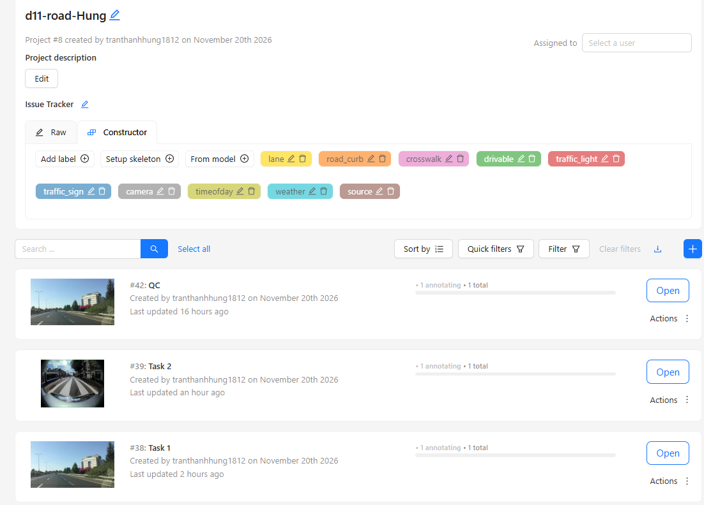
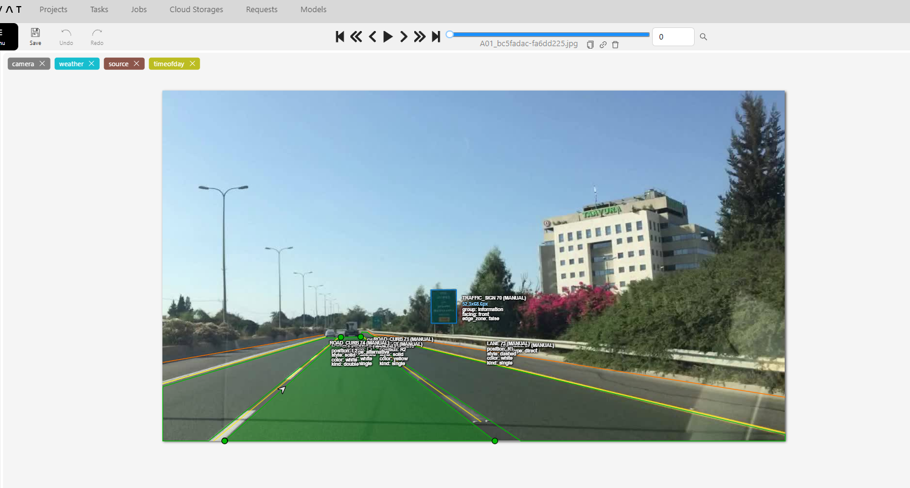
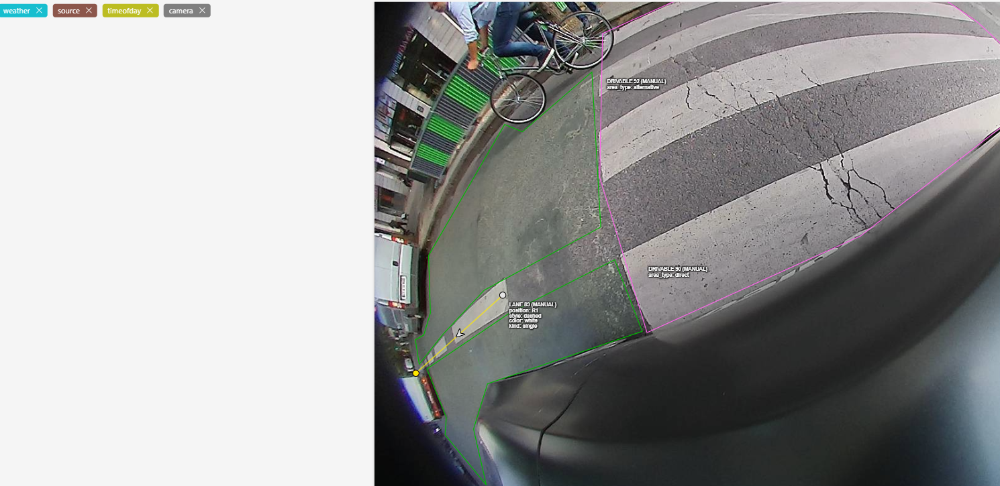
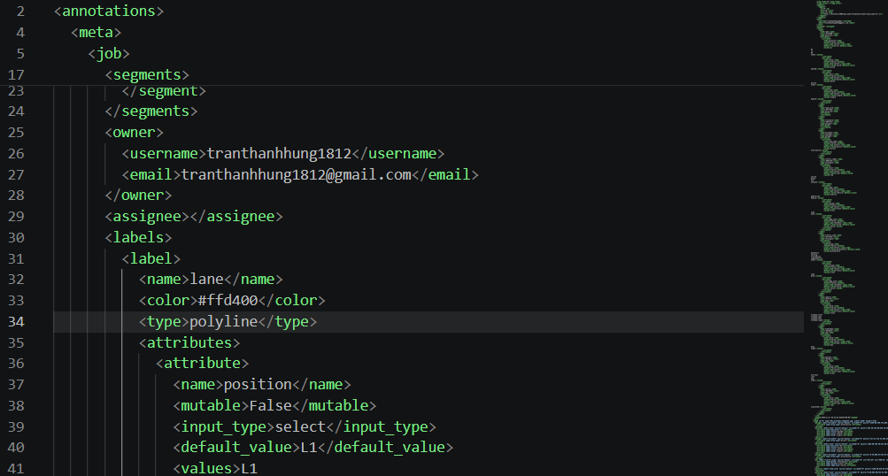

# Báo cáo cá nhân — Ngày 11
Họ tên: Trần Thành Hùng               Mã học viên: 2A202603247 
Phiên bản CVAT (Help → About):  
Guideline: Road v1.0    
Lần nộp (`revision` trong manifest):  
Thời điểm export (ngày giờ trên CVAT):    
Số lần nộp lại sau Rework:  
Link Drive : https://drive.google.com/drive/folders/11ZxH00uMycXVtbMb24Bxu8bCqD_8AgnV?usp=sharing

## 1. Kiểm project
| Mục | Đúng như guideline Road v1.0? | Ghi chú |
| --- | --- | --- |
| 6 label, đúng kiểu | Có | Có đủ `lane`, `road_curb`, `crosswalk`, `drivable`, `traffic_light`, `traffic_sign`. |
| Thuộc tính và giá trị | Có | Các thuộc tính lane, drivable, traffic_light và traffic_sign được ghi trong XML. Cần sửa các lane ở fisheye hai bên thành `position=other`. |
| 4 tag ảnh | Có | Cả 28 ảnh đều có đủ `camera`, `timeofday`, `weather`, `source`. |

Cách kết thúc polyline trên bản CVAT này: Bấm phím **N** để kết thúc polyline.  
Cách đặt tag ảnh trên bản CVAT này: Chọn công cụ **Tag**, đặt lần lượt `camera`, `timeofday`, `weather`, `source`, sau đó mở **Details** để kiểm tra giá trị.

## 2. Số lượng đã gán
| Task | Ảnh | lane | road_curb | crosswalk | drivable | traffic_light | traffic_sign |
| --- | ---: | ---: | ---: | ---: | ---: | ---: | ---: |
| front | 12 | 37 | 13 | 11 | 26 | 32 | 30 |
| front-extra (đã làm 4 / 4) | 4 | 8 | 2 | 7 | 7 | 4 | 11 |
| fisheye | 8 | 6 | 2 | 12 | 8 | 9 | 7 |
| fisheye-extra (đã làm 4 / 4) | 4 | 0 | 0 | 6 | 4 | 0 | 0 |

## 3. Bảng ca khó
| Ảnh | Nhãn | Phân vân giữa | Đã chọn | Lý do |
| --- | --- | --- | --- | --- |
| B06 | lane | `L1`, `R1` hoặc `other` | `L1` | Camera fisheye trái bắt buộc dùng `position=other`, chưa đúng guideline. |
| B07 | lane | `L1`, `R1` hoặc `other` | `R1` và `L1`  | Camera fisheye phải dùng `position=other` ở camera hai bên. |
| B08 | lane | `L1`, `R1` hoặc `other` | `R1`  | Camera fisheye phải dùng `position=other` ở camera hai bên. |
| B01 | road_curb | Polyline có ít điểm hay đi theo cung cong | 2 điểm | Fisheye cần nhiều điểm hơn ở phần cung cong. |
| B03 | lane | Polyline ít điểm hay đi theo cung cong | 2 điểm | Cần thêm điểm để mô tả cung của vạch trên fisheye. |
| B04 | lane | Polyline ít điểm hay đi theo cung cong | 3 điểm | Cần thêm điểm ở vòng ngoài và chỗ cung cong nhất. |
| B06–B08 | lane fisheye | Position `L1/R1/L2/R2` hay `other` | Giá trị hiện tại chưa sửa | Bắt buộc dùng `position=other` ở fisheye_left và fisheye_right. |
| A03 | lane R1 | Một hay hai polyline | Hai polyline cùng `R1` | Vạch đứt phải được gán bằng một polyline. |
| A04 | lane L2 | Một hay ba polyline | Ba polyline cùng `L2` | Vạch đứt phải là một polyline, không tách thành nhiều polyline. |
| B02, B03, B04, B05 | đèn/biển fisheye | Bật hay tắt `edge_zone` |  | Cần bật `edge_zone` khi tâm box nằm ngoài 80% bán kính fisheye. |

## 4. Phiếu QC 1 nhận được

Bạn kiểm lô của tôi: 2A202603259 
Quyết định nhận được: **Rework**

| Mã lỗi | Số lỗi | Đồng ý? | Đã sửa? |
| --- | ---: | --- | --- |
| QC1-04 tâm vạch | 1 | Đồng ý | Đã sửa |
| QC1-08 đèn, màu | 2 | Đồng ý | Đã sửa |
| QC1-09 facing, type, group, biển phụ | 1 | Đồng ý | Đã sửa |
| QC1-02 đủ L1, R1 | 0 | Ca A05 không có vạch sơn nên không vẽ |Đã sửa |
| Lane ngăn cách L1 | 1 | Đồng ý | Đã sửa |

**Tổng kết:**

- Lỗi nặng: 0.
- Lỗi chính: 4 / 68 nhãn = 5,9%.
- Lỗi nhẹ: 0.
- Ca chờ lead: 1 tại ảnh A05.
- Quyết định: **Rework**.
- Lý do: Tỉ lệ lỗi chính 5,9% vượt ngưỡng 5%. Ca A05 chờ lead không làm thay đổi kết luận.

**Danh sách lỗi nhận được:**

| # | Mã | Ảnh | Nhãn | Mức | Mô tả |
| ---: | --- | --- | --- | --- | --- |
| 1 | QC1-08 | A06 | `traffic_light` | Chính | Thiếu 3 đèn giao thông chưa được gán nhãn. |
| 2 | QC1-04 | A06 | `lane` | Chính | Thiếu lane ngăn cách ở bên trái. |
| 3 | QC1-09 | A04 | `traffic_sign` | Chính | Bỏ sót nhiều biển giao thông. |
| 4 | QC1-08 | A03 | `traffic_light` | Chính | Thiếu đèn xanh ở xa, khoảng tọa độ (707,314). |

## 5. Kiểm file export
| File | Mở lại được? | Số shape ảnh 1 (job / file) | Số shape ảnh 2 (job / file) | Tag camera có trong XML? |
| --- | --- | --- | --- | --- |
| Hung-front.xml | Có thể đọc và lint được bằng `road_check` | A01: 10 shape trong file | A02: 8 shape trong file | 16/16 ảnh có `camera=front` |
| Hung-fisheye.xml | Có thể đọc và lint được bằng `road_check` | B01: 6 shape trong file | B02: 6 shape trong file | 12/12 ảnh có camera fisheye đúng |

## 6. Ảnh chụp màn hình
1. Tab Labels của project.

   

2. Một ảnh camera trước đã gán đủ (làn, vùng lái, đèn/biển).

   

3. Một ảnh fisheye đã gán, phóng to đoạn polyline cong.

   

4. Một đoạn XML có `<polyline label="lane">`.

   

## 7. Tự đánh giá
Lỗi mắc nhiều nhất: QC1-11 — một số lane và road_curb fisheye có quá ít điểm, chưa mô tả đúng cung cong trên ảnh.

Cách tránh :

- Luôn kiểm camera trước khi gán lane.
- Ở fisheye_left và fisheye_right, gán `position=other`.
- Thêm điểm lane ở phần cung cong và vòng ngoài fisheye.
- Không gán lane trên thân xe mình hoặc vùng tối viền ảnh.
- Gán một vạch đứt bằng một polyline, không tách thành nhiều polyline.
- Kiểm tra `edge_zone` khi tâm box đèn hoặc biển nằm ngoài 80% bán kính fisheye.
- Xóa điểm trùng và kiểm lại tất cả thuộc tính trước khi export.

Nhãn của tôi đi vào model ở đâu:

- Lane sai `position` ở fisheye làm model không hiểu đúng vị trí tương đối của lane.
- Polyline ít điểm hoặc không theo cung làm model học sai hình học lane trên fisheye.
- Hai lỗi này có thể khiến LKA dự báo sai tâm lane, sai vị trí lane hoặc mất lane ở vùng cong ngoài ảnh.
- Nếu nhãn lane bị trùng, lệch hoặc thiếu điểm, mô hình sẽ học một ranh giới lane không chính xác.

## 8. (Tùy chọn, buffer) Từ polyline đến đích row-anchor
| y | 720 | 680 | 640 | 600 | 560 |
| --- | ---: | ---: | ---: | ---: | ---: |
| x của chúng tôi |  |  |  |  |  |
| x của bạn kia |  |  |  |  |  |

Trả lời 3 câu:

1. Năm số x đó chính là đích mà một model row-anchor học cho vạch này. Nếu bạn dừng polyline sớm 40 px, hàng nào đổi thành "không có làn"?
2. So với bạn được kiểm (cùng ảnh): ở hàng 720 và hàng 560, hai bạn lệch nhau bao nhiêu pixel? Lệch ở hàng nào ảnh hưởng LKA nhiều hơn (slide 25)?
3. Nếu polyline vẽ từ xa về gần (ngược quy tắc 2), cách tính trên có đổi không? Script nào sẽ gặp khó?
